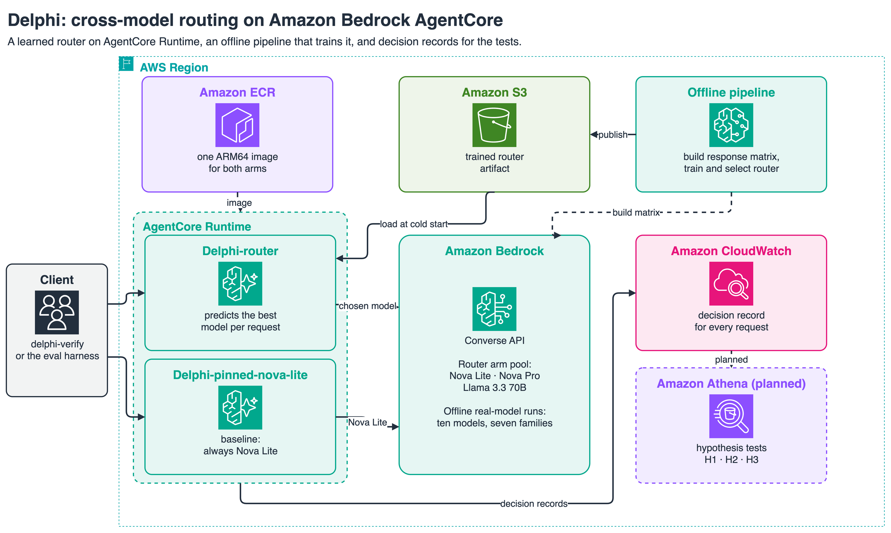

# Delphi: cross-model routing on Amazon Bedrock AgentCore

Delphi is a learned query router. It reads each request, predicts which foundation model in a
**candidate pool** will answer it best, and sends the request to that model through the Amazon
Bedrock Converse API. The router runs serverless on Amazon Bedrock AgentCore Runtime. Delphi also
comes with a test harness that checks whether routing beats sending every request to one model,
and reports a negative result when it does not.

Amazon Bedrock already has a native router,
[Intelligent Prompt Routing](https://docs.aws.amazon.com/bedrock/latest/userguide/prompt-routing.html),
which chooses between models in the same model family, for example a smaller and a larger Claude
model: a same-family choice. Delphi routes across model families, such as Nova, Llama, Gemma and
Claude, and learns which family's model to call for each request. The reasoning behind that
design is in [`docs/design.md`](docs/design.md).

This repository is the companion code for a blog post on AWS Builder Center, which walks through
how the router is built, the tests it has to pass, and what happened against real Bedrock
models.

This is sample code, for non-production usage. Work with your security and legal teams to meet
your organizational requirements before deployment.

## How Delphi works



Delphi has three parts:

- **The router agent** reads a prompt, turns it into a feature vector, predicts a quality score
  for each candidate model, and calls the model with the highest score. It runs in a container
  on AgentCore Runtime. The routing decision is a small calculation inside the container, so it
  adds no network call. Each request writes one **decision record**: the chosen model, the
  predicted scores, the tokens used and the cost.
- **The offline pipeline** builds the data the router learns from. It sends every question in a
  dataset to every candidate model, scores each answer and records its cost. The result is the
  **response matrix**: one row per question, one column per model. The best possible router,
  the **oracle**, picks the top-scoring model for every question with hindsight; the gap between
  the oracle and the best single model is the most routing can ever gain.
- **The evaluation harness** decides whether routing was worth it. It runs statistical tests
  against three hypotheses (below), and an **oracle gate** stops the experiment early when the
  models fail on the same questions, because no router can help then.

For the request path, the router can be one of three families: linear, prototype or k-nearest
neighbours. Each is trained offline on the response matrix and chosen on a validation split.

## Run the method offline

You can run the whole method on your own machine first. It needs no AWS account, no
credentials and no network:

```bash
python3 -m venv .venv && .venv/bin/pip install -e '.[dev]'
.venv/bin/python scripts/run_phase1_synthetic.py   # build the response matrix, run the oracle gate
.venv/bin/python scripts/run_phase2_synthetic.py   # train the router families, select, round-trip
```

Both scripts use the synthetic "Delphi Trials": generated questions answered by a fictional
council of six advisors that stands in for real models. They write only below the directory you
run them from (`data/phase1_synthetic/` and `artifacts/phase2_synthetic/`), and the pipeline is
deterministic, so a repeat run gives the same verdict. These runs illustrate the method on a
synthetic pool; they are not evidence about model quality. The figures they print are listed
under [Develop and test](#develop-and-test).

## The three hypotheses and results

Delphi tests three hypotheses, each written down before any run:

- **H1, cost:** quality within 2 points of the best single model, at ≥30% lower cost.
- **H2, quality:** quality above every single model. H2 needs the models to fail on different
  questions, so the oracle gate checks for that before any router is trained.
- **H3, learnability:** the router captures ≥60% of the oracle gap.

The pipeline has also run against ten real Bedrock models from seven families, on questions from
the sample's own generator. On the training run's test split, H3 passed and H1 and H2 failed:
one of the cheapest models, Gemma 3 27B, was already as good as the strongest, so routing had
little to save. A follow-up test on 520 new questions, separate from H1, H2 and H3 and also
written down before the run, then passed: the frozen router stayed within 2 points of Claude
Sonnet 5.5 at about 80% lower cost. Gemma 3 27B on its own did as well as the router at about a
ninth of the router's cost, so always name the model a saving is measured against.

These are short synthetic questions, not a production workload.
The verdict on a real domain dataset is pending: that Phase 4 run is out of scope for this sample. The write-ups and
aggregate results are in `results/`. The raw model answers, and the router trained on them, are
not published because they are third-party model outputs; the `scripts/run_*_real.py` scripts
regenerate them in your own AWS account, at your own cost.

## Cost basis

Read this before you deploy. Every cost Delphi reports can be re-priced. Each `DecisionRecord`
(`src/delphi/agent/telemetry.py`) carries `chosen_model_id`, `input_tokens` and `output_tokens`,
and `tokens_by_model` in `delphi.eval.cost` (`src/delphi/eval/cost.py`) totals the tokens per
model, so you can apply your own prices to the same token counts.

Model prices come from pinned snapshots, one per pool file, and each snapshot names the region it
was pulled for:

- `config/models_realpool.yaml` prices the router arm; its snapshot region is us-west-2, pulled
  2026-07-15.
- `config/models.yaml` prices the pinned arms and `scripts/estimate_phase1_budget.py`; its
  snapshot region is us-east-1, pulled 2026-07-14, which differs from the author's deployment
  region, us-west-2.
- `config/models_synthetic.yaml` prices no deployed arm: only `scripts/run_phase1_synthetic.py`
  and `scripts/run_phase2_synthetic.py` read it, and its region, mount-parnassus-1, is fictional
  (pulled 2026-07-14). Those synthetic runs illustrate the method and are not evidence about
  model quality.

Nothing in the code compares a snapshot's region with the region an arm runs in.
The region you deploy to is whatever your AWS environment resolves at deploy time. If it is not
a snapshot's region, re-price from current AWS pricing for your own region before you rely on
any cost.

A deployment accrues cost in five places: model inference through Bedrock Converse;
AgentCore Runtime for each arm; ECR for the container image; CloudWatch and X-Ray for logs,
metrics and traces; and S3 for the router artifact. In create mode the stacks provision the S3
bucket in a separate stack that retains it. In existing mode they reference an existing S3
bucket by name and never manage it. Only model inference is priced by a pinned snapshot in this
repository; price the other categories from current AWS pricing for your region. This section
states no amount on purpose.

These are running costs of the mechanism, not a measure of routing quality: the deployed router
is synthetic-trained, so the bill tells you what the mechanism costs, not whether routing pays
off.

## Status and deployment

The AWS CDK app in `infra/` deploys two **arms**, each its own stack, deployed by name. An arm is
one version of the system that receives the same test traffic:

- `Delphi-router`, the router arm, routes across Nova Lite, Nova Pro and Llama 3.3 70B.
- `Delphi-pinned-nova-lite`, the pinned baseline arm, always calls Nova Lite.

Both arms run the same container image; only the `DELPHI_ARM` setting differs, so any measured
difference between them comes from routing. The router arm runs an artifact trained on the
synthetic pool, not the routers measured on real models, so a deployed arm demonstrates the
mechanism (route, then Bedrock Converse, then a decision record) and is not a result about
routing quality.

[`docs/deployment.md`](docs/deployment.md) is the step-by-step guide: bootstrap, create the
artifact bucket, publish the router artifact, `cdk deploy` each arm by name, verify, and tear
down. Use a dedicated account, and follow its teardown steps when you finish.

Delphi uses the current AgentCore tooling:

- **SDK:** `bedrock-agentcore` (`BedrockAgentCoreApp`, `@app.entrypoint`).
- **Infrastructure:** the AWS CDK L1 construct `aws_bedrockagentcore.CfnRuntime`
  (`AWS::BedrockAgentCore::Runtime`), aws-cdk-lib 2.261.0 or later.
- **Calls:** `invoke_agent_runtime` in the `bedrock-agentcore` data plane.

The serving image is pinned: its base image by digest in the `Dockerfile`, and its four direct
Python dependencies to exact releases in `requirements-agent.txt`. Their own transitive
dependencies are not locked, so two builds months apart can still resolve different versions of
those. To take upstream fixes, bump the pins deliberately and re-run `pip-audit`. The image runs
as a non-root user.

## Verify a deployment

After you deploy an arm (see [`docs/deployment.md`](docs/deployment.md)), check it end to end
with one command:

```bash
delphi-verify --arn <your-runtime-arn>
```

It invokes that one runtime and prints the routing decision plus the decision record for the
invocation. The ARN is required, as `--arn` or the `DELPHI_RUNTIME_ARN` environment variable,
and has no default. The region is read from the ARN, and credentials come from your standard
AWS credential chain. Inbound auth is IAM SigV4, so those credentials need
`bedrock-agentcore:InvokeAgentRuntime` on that ARN. Add `--prompt` to send your own prompt, or
`--json` to print the decision record alone. Each run is one real, billed invocation (see
[Cost basis](#cost-basis)).

A passing check shows the mechanism works (route, then Bedrock Converse, then a decision record).
It is not a measure of routing quality, because the deployed router is synthetic-trained.

## Develop and test

```bash
PATH="$PWD/.venv/bin:$PATH" bash scripts/ci.sh   # the full gate: ruff, then the test suite and coverage floor
.venv/bin/python -m pytest                       # the test suite alone
.venv/bin/python scripts/estimate_phase1_budget.py   # token-budget model for a real-data run

# The offline method, with the figure each command prints:
.venv/bin/python scripts/run_phase1_synthetic.py                # gate PASSES (gap 27.55)
.venv/bin/python scripts/run_phase1_synthetic.py --mode nested  # gate also PASSES (gap 3.53)
.venv/bin/python scripts/run_phase1_synthetic.py --mode nested --n 40 --seed 8  # gate FAILS (gap 0.00)
.venv/bin/python scripts/run_phase2_synthetic.py                # H3 capture 0.779 on test
```

`tests/test_evidence_figures.py` runs these commands and fails if a figure here stops matching.
The third command is the case the oracle gate exists for: when the advisors fail on the same
questions, the gate stops the run before any router is trained. Nested mode is unstable across
`--n` and `--seed`, which is why it still passes at the defaults. These synthetic runs illustrate
the method; they are not evidence about model quality. More detail is in
[`docs/phase1_pipeline.md`](docs/phase1_pipeline.md) and
[`docs/phase2_training.md`](docs/phase2_training.md).

Tests marked `xfail` are wired for later phases that need a real domain dataset.

## Repository layout

```
src/delphi/
  agent/           the router agent: app.py, entrypoint.py (BedrockAgentCoreApp), bedrock.py
                   (Converse), runtime_client.py, telemetry.py (decision records)
  router/          router contract, baselines and the oracle, learned-router wrapper, features
  data/            question schema, the synthetic "Delphi Trials" generator, splits
  eval/            response matrix, statistical tests, cost, scoring, the oracle gate
  train/           router families (linear, prototype, knn), training and selection, artifacts
  verify/          the command-line client that checks a runtime end to end
  config.py        candidate pools and pricing
config/            candidate pools with pinned price snapshots, workload
infra/             AWS CDK app: one stack per arm, plus the artifact bucket stack
scripts/           offline pipeline runs (synthetic and real-model) and the budget estimate
results/           write-ups and aggregate results of the real-model runs
evidence/nfr1/     a routing-overhead latency sample measured on the router arm
docs/              design, deployment guide, pipeline and training notes, diagrams
tests/             the test suite
Dockerfile         ARM64 container image (AgentCore Runtime requires arm64)
```

## What runs where

- **On AgentCore Runtime:** the request path, which is `src/delphi/agent`, `src/delphi/router`,
  `src/delphi/config.py`, `src/delphi/failure_log.py`, and parts of `src/delphi/eval` and
  `src/delphi/train` (partial: only the modules the request path imports, as the package
  docstring lists). A test compares this list with the code.
- **On your machine:** the verification client (`src/delphi/verify`), which invokes an AgentCore
  runtime; the container never imports it.
- **Offline (your machine, SageMaker or EC2):** dataset generation, response-matrix builds,
  scoring and router training (`src/delphi/data` and the rest of `src/delphi/eval` and
  `src/delphi/train`, driven by `scripts/`).
- **Analytics:** decision records go to CloudWatch, then S3 and Athena for the hypothesis tests.

## Executing generated code

The `pass_at_1` scorer (`src/delphi/eval/scoring.py`) checks a model's code answer by running
it. It is **off by default**: it refuses to execute model output unless you opt in, with
`allow_exec=True` or `DELPHI_ALLOW_UNSANDBOXED_EXEC=1`, and `scripts/ci.sh` always unsets that
variable. When enabled, the code runs in a child process (`src/delphi/eval/runner.py`,
`src/delphi/eval/cell_harness.py`) with an empty environment, a restricted set of builtins and a
per-cell timeout. **That child process is not a sandbox.** Restricted builtins can be escaped,
and the child runs with your user's file system and network access. Do not enable it on
untrusted model output outside a disposable, isolated environment, such as a microVM or a
seccomp-confined container with no credentials and no network. The offline demos and the
real-model runs do not need it.

## Security

See [CONTRIBUTING](CONTRIBUTING.md#security-issue-notifications) for more information.

## License

This library is licensed under the MIT-0 License. See the [LICENSE](LICENSE) file.
